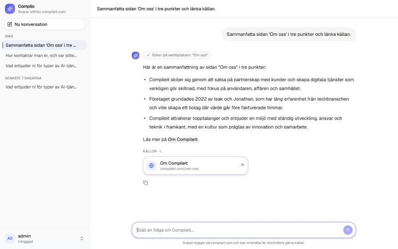
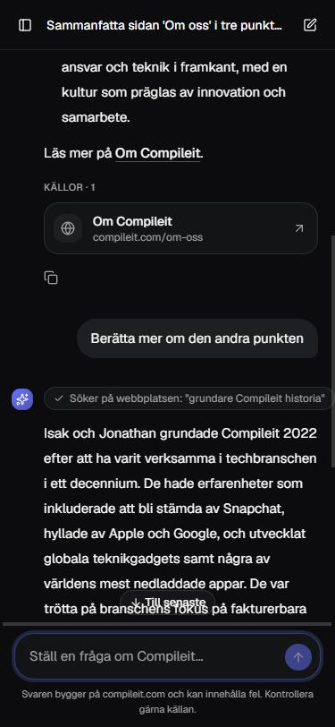
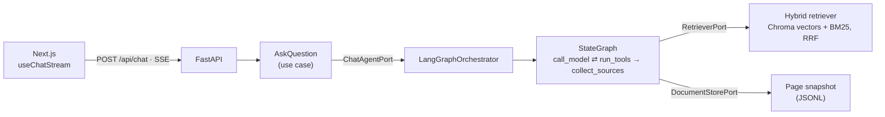

# Compileit chat

A chat that answers questions **in Swedish** about [compileit.com](https://compileit.com). It
streams its answers, shows what the agent is doing, cites its sources, and says clearly when
something is not on the site.

<p>
  
  
</p>

**Stack:** Python 3.12 · FastAPI · LangChain + LangGraph · OpenAI · Chroma · Next.js 16 ·
TypeScript · Tailwind · shadcn/ui

## Quick start

Requires Docker and an OpenAI API key. No secret or credential lives in the code.

```bash
cp .env.example .env
docker compose run --rm api compileit-chat new-master-key       # paste into SECRETS_MASTER_KEY in .env
docker compose run --rm api compileit-chat set-secret openai_api_key   # stored encrypted in the DB
docker compose run --rm api compileit-chat create-user <username>      # prompts for a password
docker compose up --build     # or: make dev, then open http://localhost:3000 and log in
```

The first start builds the search index from the committed crawl snapshot (~10 s, under a
cent of embeddings). The database (accounts, history, logs, secrets), the index and the
agent's memory persist in a Docker volume. Setting `OPENAI_API_KEY` in `.env` also works,
as a fallback.

<details>
<summary>Without Docker (uv + Node 24)</summary>

```bash
make install    # backend deps (uv), frontend deps (npm), pre-commit hooks
make api        # http://localhost:8000; builds the index on first start
make web        # http://localhost:3000, in a second terminal
```
</details>

## What it does

- **Answers only from the site, in Swedish.** Every turn starts with a hybrid search of
  compileit.com. Answers link their sources inline, and the UI shows them as cards.
- **Says so when it doesn't know.** "Det hittar jag inte på compileit.com." Off-topic
  questions are politely declined. Website text is treated as untrusted data.
- **Follow-ups work.** "Berätta mer om den andra punkten" is reformulated into a concrete
  search.
- **Accounts and saved history.** Users log in with a username and password, and their
  conversations are saved in the database and listed in a side panel, on any device.
  Every login and every chat call is logged.
- **Visible agent activity.** «Söker på webbplatsen: "AI-tjänster"…» streams while tools
  run, then the answer streams token by token. Stop, retry, copy and "Ny konversation".
- **Responsive and accessible:** mobile-first, keyboard friendly, dark mode, and screen-reader
  status announcements instead of per-token chatter.

## Architecture



Clean Architecture: `domain` and `application` are framework-free, and every framework
(LangGraph, OpenAI, Chroma, FastAPI) lives in an adapter behind a port, wired in
`container.py`. `import-linter` enforces the dependency rule in CI. Details, the request
sequence, and the orchestration graph **generated from code** are in
[`docs/architecture.md`](docs/architecture.md). The decisions are in [`docs/adr/`](docs/adr/).

```
backend/src/compileit_chat/
  domain/          Document, Chunk, SourceRef, SessionId, Question, citation rules
  application/     ports (Protocols), use cases, stream-event DTOs
  infrastructure/  orchestration/ (LangGraph), retrieval/, crawling/, chunking/, vectorstore/, …
  interface/       api/ (FastAPI, SSE), cli/ (ingest, docs)
  container.py     composition root
frontend/          app/, components/chat/, hooks/useChatStream.ts, lib/ (SSE parser, reducer, API)
```

## Why this design

- **A tool-calling agent, not a fixed RAG chain.** "Sammanfatta sidan 'Om oss'" needs a
  whole page, a follow-up needs a rewritten query, and Tesla needs a refusal. The agent picks
  between `search_website`, `get_page` and `list_pages`
  ([ADR-0002](docs/adr/0002-langgraph-agent-with-tools.md)).
- **Orchestration you can read.** It is a hand-built LangGraph `StateGraph` with explicit
  state, a pure routing function, an iteration budget and a fallback node, not a prebuilt
  agent. Guarantees live in the graph; judgement lives in the prompt. Example: the first step
  of every turn *must* search, because the eval showed the prompt alone did not ensure it
  ([ADR-0007](docs/adr/0007-custom-orchestrator-and-responsibilities.md)).
- **Clean Architecture, enforced.** Swapping LangGraph, OpenAI or Chroma touches one adapter
  and the container. Use cases are tested with in-memory fakes, and `import-linter` fails CI
  on a wrong-way import ([ADR-0001](docs/adr/0001-clean-architecture.md)).
- **Measured, not assumed.** Textbook hybrid retrieval was *worse* than vector-only on this
  corpus until BM25 was limited to its top 3 hits
  ([ADR-0003](docs/adr/0003-hybrid-retrieval.md)). The eval took the agent from 11/18 to
  17/18 ([eval report](docs/eval-report.md)).
- **Streaming over plain HTTP.** SSE with our own typed events (`token`, `tool_start`,
  `sources`, `done`, `error`); no LangChain types reach the API
  ([ADR-0005](docs/adr/0005-sse-over-websockets.md)).

## Accounts, history and secrets

Everything is stored in one database (`DATABASE_URL`; a SQLite file by default, so
PostgreSQL is a URL change) with a schema managed by Alembic migrations that run on startup
([ADR-0008](docs/adr/0008-accounts-history-and-secrets.md)).

| Table | What | Protection |
|---|---|---|
| `users` | accounts, created by an admin with `compileit-chat create-user` | Argon2id hashes only |
| `auth_sessions` | login sessions (HttpOnly, SameSite cookie) | only the token's SHA-256 is stored |
| `login_events` | every login attempt, successful or not | username, result, IP, time |
| `conversations`, `messages` | each user's chat history | strict per-user isolation (others see 404) |
| `api_calls` | every chat call: question, answer, sources, tools, status, latency | kept even if the conversation is deleted |
| `secrets` | the OpenAI API key | Fernet-encrypted; the master key is only in the environment |

Admin commands (in Docker: prefix with `docker compose run --rm api`):

```bash
compileit-chat create-user <username>            # password prompted hidden, or --password-stdin
compileit-chat set-secret openai_api_key         # value prompted hidden, or --value-stdin
compileit-chat new-master-key                    # a new SECRETS_MASTER_KEY
compileit-chat db-upgrade                        # apply migrations (also done on startup)
```

## Example questions

| Question | Expected behaviour |
|---|---|
| Vad erbjuder ni för typer av AI-tjänster? | AI agents as digital colleagues, process automation, free consultation; cites `/tjanster/ai` |
| Vilka branscher jobbar ni med? | Fetches `/uppdrag` and gives a compilation from their customers, labelled as such (the site lists no industries) |
| Hur kontaktar man er, och var sitter ni? | Form or hello@compileit.com; offices in Stockholm, Kalmar, Skövde with addresses |
| Har ni beskrivit hur ni jobbar med säkerhet/sekretess? | Privacy policy: technical and organisational measures, limited access |
| Sammanfatta sidan 'Om oss' i tre punkter och länka källan. | Three points, linked to `/om-oss` |
| → Berätta mer om den andra punkten | Searches for the specific topic (e.g. the founders' story) and expands on it |
| Vad kostar en Tesla? | Politely declined: it only answers about Compileit |
| Har ni kontor i Göteborg? | Says it is not on the site, and lists the offices that are |

Verbatim answers from the running stack: [`docs/example-answers.md`](docs/example-answers.md).

## Evaluation

`make eval` runs 18 golden questions through the real stack and has `gpt-4.1` judge
faithfulness against the pages the agent read (it costs a few cents, so it is not part of
CI). Latest results, stable over two consecutive runs:

| Metric | Result |
|---|---|
| Overall pass rate | **17/18** |
| Agent retrieved an expected page | 100% |
| Answers citing a source / the expected source | 100% / 100% |
| Out-of-scope refused (incl. prompt injection) | 4/4 |
| "Not on the site" answered as such | 2/2 |
| Faithfulness (judge, 1–5) | 4.7 |
| Median time to first token | 1.6 s |

The one failure, the industries question, and how each finding changed the system are in
the [eval report's tuning log](docs/eval-report.md#tuning-log).

## Quality

```bash
make check    # ruff, import contracts, mypy --strict, pytest · ESLint, Prettier, tsc, Vitest
```

| | |
|---|---|
| Backend | 203 tests. Unit tests (domain, use cases with fakes incl. login, history and audit, routing, nodes, chunker, crawler against a fake site); integration tests (Chroma, the real Alembic migration and SQL repositories, encrypted secrets, the real LangGraph graph with a scripted chat model, the HTTP API end to end incl. login cookies and per-user isolation); no network |
| Frontend | 51 Vitest tests: SSE parsing (split chunks, split UTF-8), reducer, history mapping, `useChatStream` against a mocked API (reopen after reload, expired session), login and conversation list |
| CI | GitHub Actions: both stacks' lint, types and tests, plus a frontend production build |
| Docs | `docs/architecture.md` embeds the orchestration graph generated from code; a test fails if it drifts |

## Assumptions

Based on inspecting compileit.com (2026-11-17) before writing the crawler:

- **Swedish only.** Every page has `<html lang="sv">`, with no `/en` section or hreflang
  alternates. Language is still recorded per page, but no language filtering is needed.
- **The sitemap is complete and allowed.** `robots.txt` is `Allow: /` and points to
  `sitemap.xml` (96 URLs). The crawler is sitemap-first and only follows links if no sitemap
  is found. `www.compileit.com` 308-redirects to `compileit.com`, which is the canonical host.
- **Server-rendered HTML** (Next.js on Vercel), so no headless browser is needed.
- **Employee profile pages are excluded** (`/medarbetare/<id>-<name>`, ~45 URLs). They are
  thin, personal pages that add retrieval noise. Leadership and contact details are on
  `/kontakt`. Configurable via `CRAWL_EXCLUDE_PATTERNS`.
- **Custom main-content extraction instead of trafilatura.** On this site trafilatura keeps
  only one block of card-based pages (368 chars of `/tjanster/ai`) and drops the headings on
  `/kontakt`. The site has a clean `<main>`, which is rendered to markdown directly.
  trafilatura is the fallback for pages without `<main>`.
- **Job ads have almost no text** on the site itself (the content is loaded from an external
  service), so questions about open positions get thin answers.
- **The crawl snapshot is committed** (`backend/data/snapshot/pages.jsonl`) rather than
  crawling on first start. This makes the app and the eval reproducible without hitting the
  site, and `git diff` after `make ingest` shows exactly what changed on the site. The vector
  index is derived data, built from the snapshot.
- **"Branscher" is inferred.** The site names customers, not industries, so the industries
  answer is a labelled compilation from `/uppdrag` (see the eval report).
- **History is server-side and per user.** The browser keeps only the id of the open
  conversation, so a reload reopens it. Everything else comes from the database.

## Limitations and next steps

- **Freshness:** content is as fresh as the last `make ingest`. Next step: a scheduled
  re-crawl (e.g. a nightly GitHub Action) that opens a PR with the snapshot diff, so content
  changes are reviewed like code.
- **Retrieval quality:** add a cross-encoder reranker over the fused top 20, and grow the
  golden set beyond 18 questions before tuning finer. 18 questions are noisy (see the eval
  report).
- **Scale-out:** SQLite sessions and the in-memory rate limiter assume one API process. Next:
  a Postgres checkpointer, a Redis rate limiter and session expiry, all behind the existing
  interfaces.
- **Accounts:** password change and reset, deactivating users, a cleanup job for expired
  sessions, master-key rotation, SSO, and a retention policy for `api_calls` (it holds
  personal data).
- **Production concerns not in scope:** abuse protection beyond rate limiting, PII handling in logs (only question length is logged today), and
  observability dashboards. LangSmith tracing is already one env var away (`.env.example`).
- **Latency:** forcing a search on every turn adds ~0.3 s to the first token, and an extra
  step for whole-page requests. It is worth it for the grounding guarantee, but a cached
  "page intent" router could skip the search for explicit page requests.

## How AI was used

This project was built with an AI coding assistant, phase by phase, with a plan before each
phase and lint, types and tests after it. The exported transcripts are in
[`ai-history/`](ai-history/). They show the decisions, the rejected options, and the places
where measurements overturned the first design (trafilatura, hybrid fusion, prompt-only
grounding).
