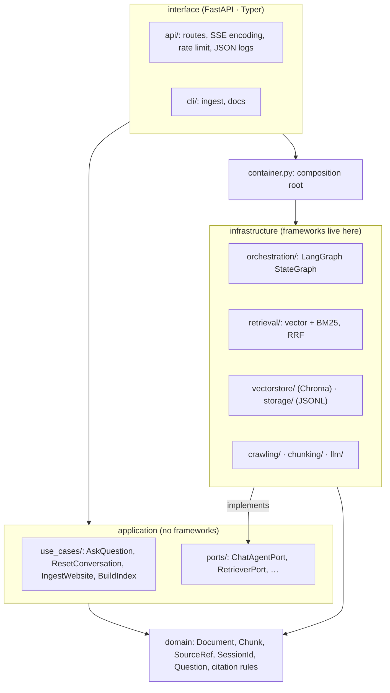
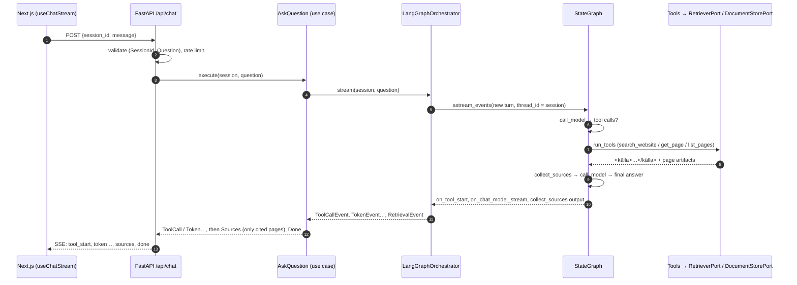
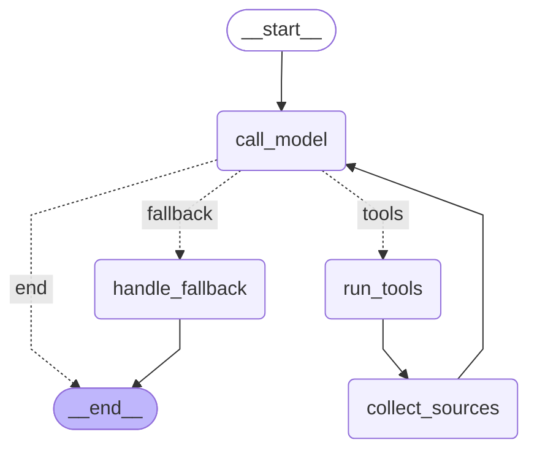

# Architecture

The backend uses Clean Architecture: framework-free `domain` and `application` layers, with
adapters around them. A hand-built LangGraph orchestrator is one of those adapters. The
frontend talks to it over Server-Sent Events. Rationale: [ADRs](adr/).

## Layers

Source-code dependencies point inward only. `import-linter` enforces this in CI
(`backend/pyproject.toml`).

## Answering a question

## Orchestration graph

Generated from `infrastructure/orchestration/graph.py` with `make docs`. A test fails if
this diagram and the code disagree.

<!-- generated:orchestration-graph:start -->

<!-- generated:orchestration-graph:end -->

| Node | Responsibility |
|---|---|
| `call_model` | Adds the system prompt to the current turn plus up to 20 earlier messages (trimmed at a user message) and asks the model for tool calls or the final answer. |
| `run_tools` | Executes every tool call of the last model message concurrently, reports bad arguments back to the model, and increments `tool_iterations`. |
| `collect_sources` | Adds the pages that the latest tool round returned to the turn's `sources`, de-duplicated. |
| `handle_fallback` | Reached when the model still wants tools after `AGENT_MAX_TOOL_ITERATIONS` rounds. Closes the open tool calls and answers with a polite Swedish fallback. |
| `should_continue` | Pure routing after `call_model`: `tools`, `fallback` or `end`. |

`AgentState` holds `messages` (merged with `add_messages`) and two per-turn fields that are
reset on every question: `sources` and `tool_iterations`. The SQLite checkpointer persists
the state per `thread_id`, which is the session id.

### Who decides what

| Concern | Owner |
|---|---|
| Input validation, error-to-message mapping, which sources to show (only cited ones), the event contract for clients | `AskQuestion`, the use case. It has no LangGraph imports. |
| Tool loop, routing, iteration budget, fallback, memory, step backstop, timeout, mapping framework events to application events | `LangGraphOrchestrator` and the graph |
| Wiring `LangGraphOrchestrator` to `ChatAgentPort` / `ConversationStorePort` | `container.py` |

## Ingestion

```mermaid
flowchart LR
    sitemap["robots.txt + sitemap.xml"] --> crawler["SitemapCrawler"]
    crawler --> extractor["MainContentExtractor (&lt;main&gt; → markdown)"]
    extractor --> dedupe["IngestWebsite: drop empty and duplicate pages"]
    dedupe --> snapshot[("pages.jsonl (committed)")]
    snapshot --> chunker["HeadingAwareChunker"]
    chunker --> embed["OpenAI embeddings"]
    embed --> chroma[("Chroma (runtime)")]
    chroma --> bm25["BM25, built lazily at first search"]
```

